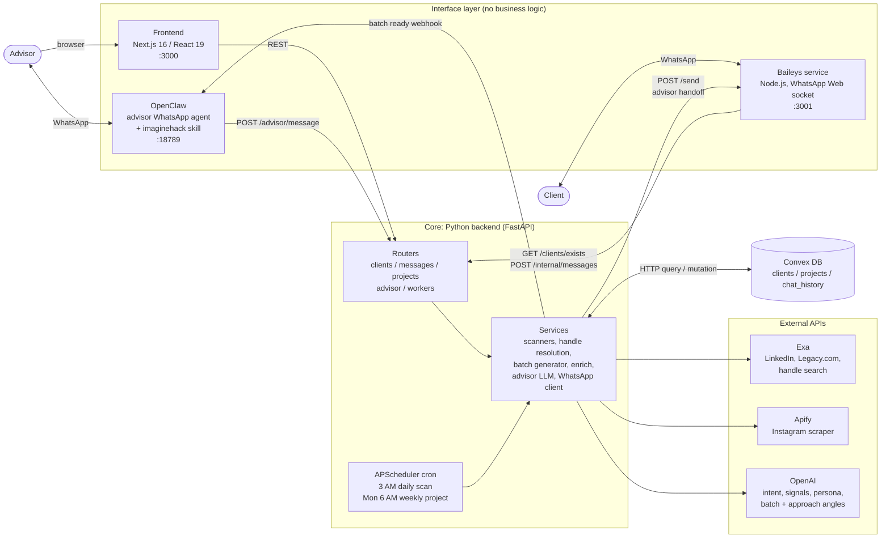
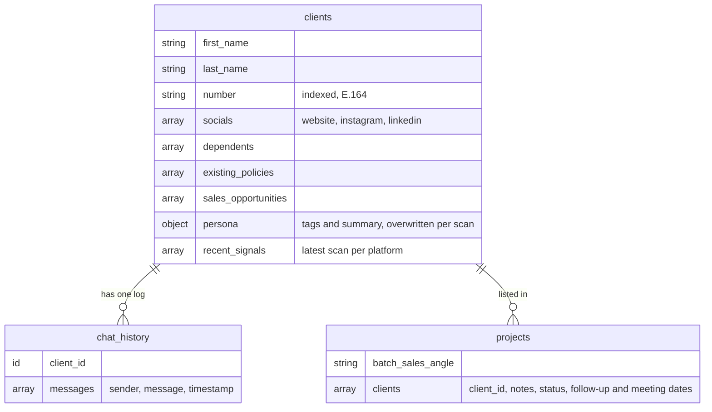
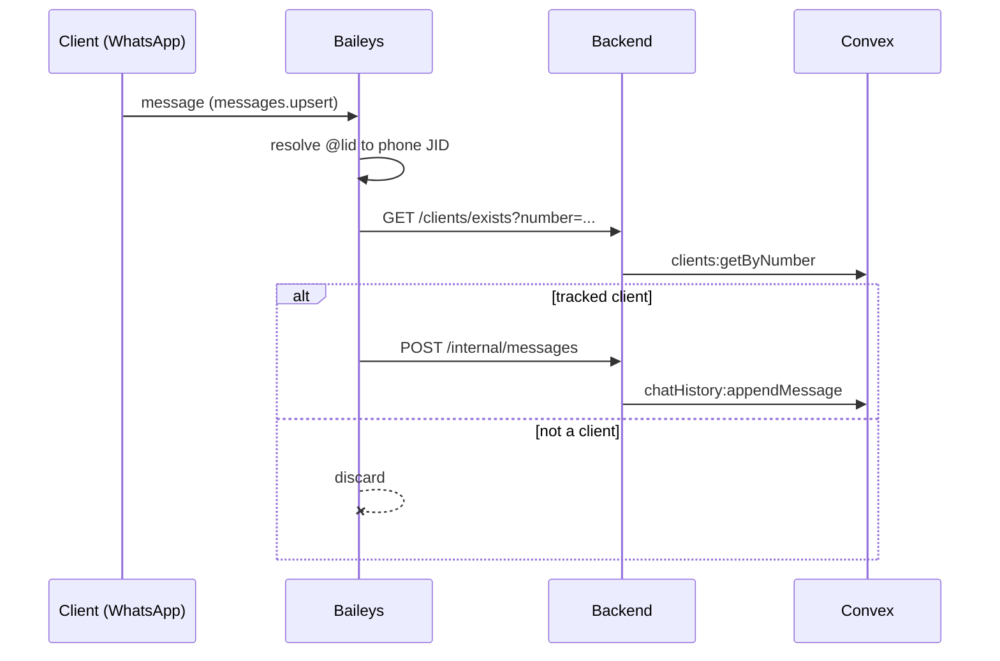
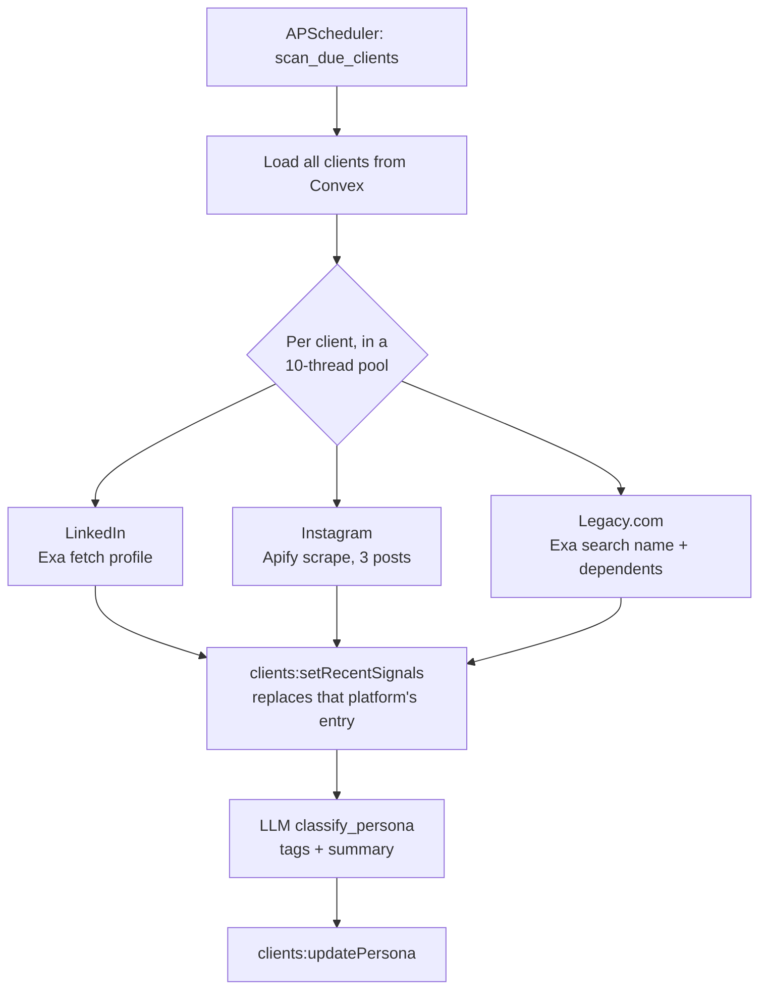
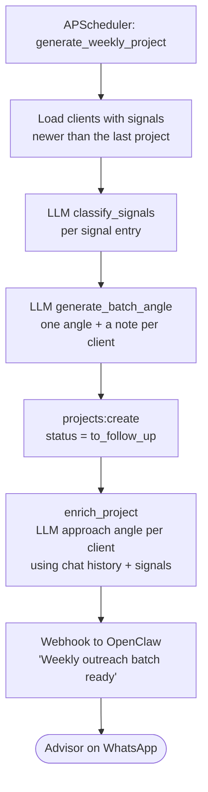
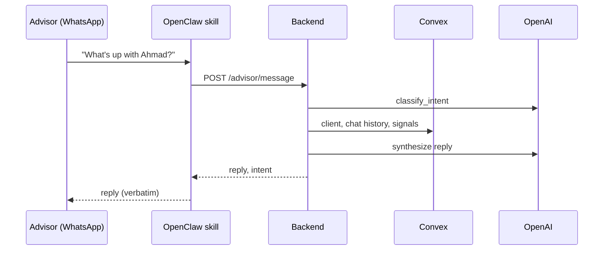

# ImagineHack

A social-listening and outreach assistant for life insurance advisors. It watches
tracked clients' public profiles (LinkedIn, Instagram, Legacy.com) for life
events, such as a new baby, a new job or a death in the family. It logs their
WhatsApp conversations and turns both into a weekly outreach project: *"work on
these clients this week, and here's why."* The advisor drives it from WhatsApp
or from a web dashboard.

> Hackathon scope: social listening, WhatsApp chat-history logging and
> advisor-triggered WhatsApp handoff. See [SPEC.md](SPEC.md) for the full spec
> and [PLAN.md](PLAN.md) for build status.

---

## Architecture

One principle runs through the whole design: **the Python backend owns all the
intelligence.** Baileys, OpenClaw and the frontend are thin I/O layers. Convex is
the single source of truth.



### Components

| Component | Path | Stack | Owns |
|---|---|---|---|
| **Frontend** | [`frontend/`](frontend) | Next.js 16, React 19, Tailwind, shadcn/ui | Advisor dashboard: clients, client detail with signals, chat history and approach angles, weekly projects and per-client status |
| **Python backend** | [`platform-api/backend/`](platform-api/backend) | FastAPI, APScheduler, httpx | All logic: LLM calls, Exa/Apify calls, cron, DB writes, intent routing, batch generation |
| **Baileys service** | [`platform-api/baileys/`](platform-api/baileys) | Node.js, Express, `@whiskeysockets/baileys` | The WhatsApp Web session, which streams messages for tracked clients to the backend and exposes `/send` for outbound |
| **OpenClaw** | [`openclaw/`](openclaw), [`Dockerfile`](Dockerfile), [`entrypoint.sh`](entrypoint.sh) | OpenClaw gateway, one skill | Advisor WhatsApp I/O only: relay each message to `/advisor/message` and send the reply back |
| **Convex DB** | [`convex/`](convex) | Convex, TypeScript | Shared state and the schema below |
| **Exa** | external | | Handle resolution, LinkedIn profile fetch, Legacy.com obituary search |
| **Apify** | external | | Public Instagram posts |
| **OpenAI** | external | | Intent classification, signal and persona classification, batch angles, approach angles |

### Data model (Convex)



`projects.clients[].status` is one of `to_follow_up`, `meeting_scheduled`,
`stale` or `followup_after_success`. `recent_signals` is replaced per platform on
each scan, not appended. Source: [`convex/schema.ts`](convex/schema.ts).

---

## Key flows

### 1. WhatsApp message logging (real time)

Baileys is reactive: WhatsApp pushes events over a persistent socket, with no
polling. Tracking needs no config. A client is tracked if their number exists in
Convex.



### 2. Daily social scan (3 AM)



Handle resolution (`/workers/resolve-handles`, and automatically before
`/workers/scan-client/{id}`) finds a missing LinkedIn URL via Exa. An LLM scores
each candidate and only a score of 6 or more is stored. Instagram handles are set
manually, either on the dashboard or by texting the advisor bot.

### 3. Weekly project (Monday 6 AM)



Other batch types (new baby and family, high-urgency events, custom filters) are
available on demand via `POST /workers/generate-*`.

### 4. Advisor command via WhatsApp



Intents are `client_summary`, `weekly_batch`, `set_handle` and `freeform`.
For "how should I approach X?" the skill can also layer a web-searched
conversation starter over the backend's base angle. See
[`openclaw/plugin-skills/imaginehack/SKILL.md`](openclaw/plugin-skills/imaginehack/SKILL.md).

### 5. Approach-angle handoff

From a client's page, the advisor picks a *direct* or *subtle* angle. The
frontend calls `POST /advisor/handoff`. The backend asks Baileys to `POST /send`
the message to the client and logs it to `chat_history` as an advisor message.

---

## Backend API surface

| Router | Endpoints |
|---|---|
| `/clients` | `POST /`, `GET /`, `GET /exists`, `GET /{id}`, `PATCH /{id}`, `POST /{id}/opportunities`, `GET /{id}/chat-history` |
| `/projects` | `GET /`, `GET /current`, `POST /`, `GET /{id}`, `POST /{id}/enrich`, `PATCH /{id}/clients/{client_id}` |
| `/advisor` | `POST /message`, `/query-clients`, `/suggest-angle`, `/suggest-angle-enriched`, `/handoff` |
| `/workers` | `POST /scan-linkedin`, `/scan-instagram`, `/scan-legacy`, `/resolve-handles`, `/scan-client/{id}`, `/generate-batch`, `/generate-baby-maternity`, `/generate-high-urgency`, `/generate-custom` |
| `/internal` | `POST /messages` (Baileys only) |
| | `GET /health` |

Backend modules: [`platform-api/backend/services/`](platform-api/backend/services)
holds `convex.py` (Convex HTTP client), `exa.py`, `apify.py`, `llm.py`,
`advisor_llm.py`, `linkedin_scanner.py`, `instagram_scanner.py`,
`legacy_scanner.py`, `handle_resolution.py`, `batch_generator.py`, `enrich.py`
and `whatsapp.py` (the Baileys `/send` client).

---

## Repository layout

```
imaginehack/
├── frontend/                 Next.js advisor dashboard
├── convex/                   Convex schema, queries and mutations, seed data
├── platform-api/
│   ├── backend/              FastAPI app, cron jobs, services (all logic)
│   └── baileys/              WhatsApp bridge (Node.js)
├── openclaw/plugin-skills/   OpenClaw skill, synced into the container on start
├── Dockerfile                OpenClaw image
├── entrypoint.sh             Syncs the skill and runs the Google Workspace MCP and the gateway
├── docker-compose.yml        backend + baileys + openclaw
├── docs/                     Per-component docs and setup guides
├── SPEC.md / PLAN.md         Full spec and build plan
└── test/                     Exa and Apify experiments and results
```

---

## Running it

`docker-compose.yml` runs three services, each reading the root `.env`:

| Service | Host port | Notes |
|---|---|---|
| `backend` | 8001 (container 8000) | FastAPI, with a `/health` check |
| `baileys` | 3001 | Persists its WhatsApp auth in the `baileys-auth` volume |
| `openclaw` | 8000, 8080, 18789 | Gateway, plus the Google Workspace MCP on 8080 |

```bash
docker compose up --build
```

Convex and the frontend run on the host:

```bash
npm install
npx convex dev        # keep Convex functions in sync
cd frontend && npm install && npm run dev   # http://localhost:3000
```

The frontend calls the backend at `NEXT_PUBLIC_API_URL`, which defaults to
`http://localhost:8001`.

**Required environment variables** (backend):
`EXA_API_KEY`, `APIFY_API_TOKEN`, `OPENAI_API_KEY`, `CONVEX_URL` and
`CONVEX_DEPLOY_KEY`. Optional: `LLM_MODEL`, `CLASSIFIER_MODEL` (both default to
`gpt-4o-mini`), `OPENCLAW_WEBHOOK_URL` and `BAILEYS_URL`.

For running each service without Docker (including the first-run WhatsApp QR
scan), see [docs/setup/local-dev.md](docs/setup/local-dev.md).

## More docs

- [docs/README.md](docs/README.md): index of component docs
- [docs/components/architecture.md](docs/components/architecture.md): design decisions and data flows
- [SPEC.md](SPEC.md): signals, handle-resolution scoring, DB schema, endpoints
